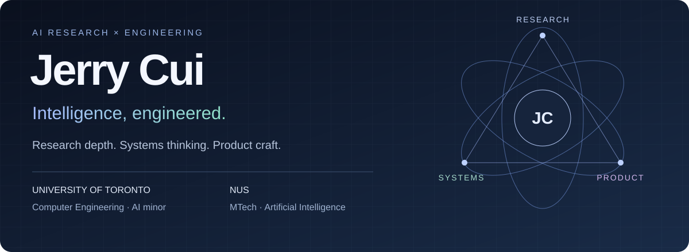
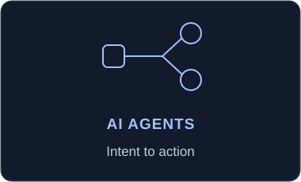
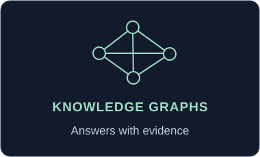
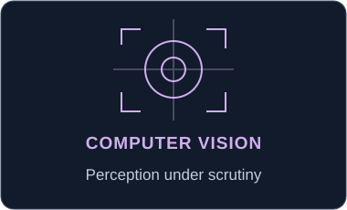
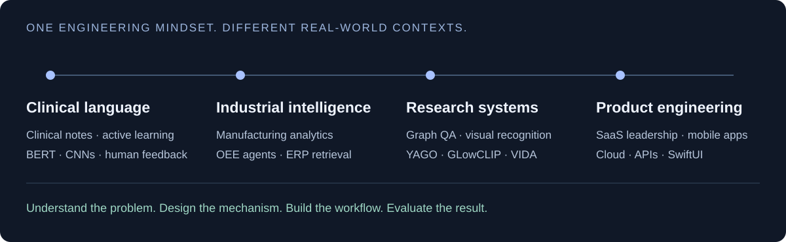

> **Open to internships and full-time roles from March 2027**  
> AI Research · AI Engineering · [Let’s connect](mailto:jiangshan1030@gmail.com)

# Jerry Cui · 崔江山

**I connect research questions, operational problems, and the engineering needed to make AI useful.**

My experience spans clinical NLP, manufacturing analytics, knowledge-graph reasoning, visual recognition, and application development. I’ve also led a five-person engineering team—bringing both model-level curiosity and experience building the surrounding system.

[LinkedIn](https://www.linkedin.com/in/jiangshancui/) · [Email](mailto:jiangshan1030@gmail.com)

## Explore my work

<table><tr>
<td width="33%"></td>
<td width="34%"></td>
<td width="33%"></td>
</tr></table>

## What I bring to a team

| Strength | How I put it into practice | Evidence |
| :--- | :--- | :--- |
| **Research translated into implementations** | Model adaptation, controlled experiments, and evaluation of failure modes | [GLowCLIP](https://github.com/Jerry00C/GLowCLIP), [VIDA](https://github.com/Jerry00C/Vida), clinical NLP research |
| **AI grounded in domain problems** | Connect language models to manufacturing data, ERP documents, and structured knowledge | [OEE Agent](https://github.com/Jerry00C/oee-analysis-ai-agent), [Plex RAG](https://github.com/Jerry00C/plex-rag), [YAGO](https://github.com/Jerry00C/yago-sparql-demo) |
| **Engineering beyond the model** | Build APIs, validation, orchestration, interfaces, and human review into an end-to-end workflow | [Chemistry Video Generator](https://github.com/Jerry00C/EduVideoGenerator), [AI Calendar](https://github.com/Jerry00C/ai-calendar) |
| **Technical leadership and collaboration** | Led five engineers at Utechia; contributed to collaborative agent systems | SaaS platform and cloud infrastructure; [real-estate assistant](https://github.com/zhexusun10/Multi-Agent-Assistance-System) |

<b>Technical toolkit — connected to actual work</b>

| Area | Tools and methods |
| :--- | :--- |
| Machine learning & vision | Python, PyTorch, CLIP, DINO, LoRA, CNNs, BERT, active learning |
| Agents & retrieval | LangChain, structured outputs, Pydantic, tool calling, SPARQL, Neo4j, Pinecone |
| Applications | FastAPI, TypeScript, Node.js, React Native, SwiftUI, Java / Android |
| Infrastructure & data | AWS, Docker, Kubernetes, Kafka, SQL, MongoDB, ClickHouse |

These reflect tools used across my projects and professional experience; the project links show where they apply.

## AI agents
**Systems that turn intent into action.**

| Project | What it explores | Engineering focus |
| :--- | :--- | :--- |
| [OEE Analysis Agent](https://github.com/Jerry00C/oee-analysis-ai-agent) | Natural-language questions about manufacturing performance | SQL tools, preprocessing, modular analytics |
| [Multi-Agent Real Estate Assistant](https://github.com/zhexusun10/Multi-Agent-Assistance-System) | Conversational property search, recommendations, explanations, and viewing coordination | Agent orchestration, preference memory, retrieval, human review |
| [Chemistry Video Generator](https://github.com/Jerry00C/EduVideoGenerator) | Chemistry questions transformed into narrated visual explanations | Reasoning, verification, scene planning, animation |
| [Project–Student Matching](https://github.com/AndyYeom/Intern-Assignment-Agent) | Structured skill requirements and constrained assignments | Multi-agent components, genetic algorithm, mentor review |
| [AI Calendar](https://github.com/Jerry00C/ai-calendar) | Screenshots and photos transformed into editable calendar events | Multimodal extraction, React Native, FastAPI, review workflow |

*Real Estate Assistant and Project–Student Matching are collaborative projects. The real-estate repository credits my native recommendation implementation. The OEE repository is a public example of company work; Calendar is an MVP; matching results are drafts for review.*

## Knowledge graphs & retrieval
**Answers with a path back to evidence.**

| Project | What it explores | Engineering focus |
| :--- | :--- | :--- |
| [YAGO LLM-to-SPARQL](https://github.com/Jerry00C/yago-sparql-demo) | Factual question answering over a knowledge graph | Structured extraction, predicate allowlists, one-hop SPARQL, visible traces |
| [Plex RAG](https://github.com/Jerry00C/plex-rag) | Questions grounded in enterprise ERP documentation | PDF ingestion, chunking, embeddings, Pinecone retrieval |

My broader research includes YAGO-to-Neo4j ingestion, FastRP graph embeddings, and knowledge-graph QA. These experiments are distinct from the public YAGO V1 demo, which uses direct one-hop SPARQL queries.

## Computer vision
**Look closer. Test what generalizes.**

| Project | What it explores | Research focus |
| :--- | :--- | :--- |
| [GLowCLIP](https://github.com/Jerry00C/GLowCLIP) | AI-generated image detection under visual degradation | CLIP, global/local feature fusion, consistency objectives |
| [VIDA](https://github.com/Jerry00C/Vida) | AI-generated video detection from complementary signals | Visual encoder adaptation, temporal features, anomaly signals, calibrated fusion |

My VIDA work focuses on visual-encoder transfer learning and evaluation. The current repository documents a broader three-branch system, including format-control tests that reveal limits of its fixed operating threshold.

## Mobile engineering
**The interface is part of the system.**

- [ReformFIT iOS](https://github.com/Jerry00C/ReformfitAppIOS): SwiftUI fitness application with class information, member features, wellness tools, Firebase, and LiveChat.
- [ReformFIT Android](https://github.com/Jerry00C/ReformfitAppAndroid): Java/AndroidX application with class schedules, booking-related workflows, Mindbody integration, and Firebase.

*These are earlier development builds; see each README for current setup and limitations.*

## Beyond the repositories

- **Clinical NLP · University of Toronto:** research on extracting social determinants of health from clinical notes using BERT, CNNs, active learning, and human feedback.
- **Enterprise AI · Wanfeng / Meridian:** manufacturing analytics and ERP knowledge retrieval.
- **Customer-data integration · Diamond Aircraft:** evaluated Salesforce, FAA, and external-data integration approaches and technical trade-offs.
- **Full-stack leadership · Utechia:** led a five-person team developing a SaaS platform and cloud infrastructure.
- **Software engineering · Informatica:** microservices collaboration and an ML-based sentiment analysis tool.

---
**Research curiosity. Engineering discipline. Product instinct.**

[Contact me about an internship or full-time opportunity](mailto:jiangshan1030@gmail.com)
