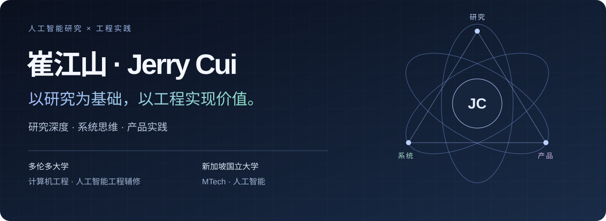
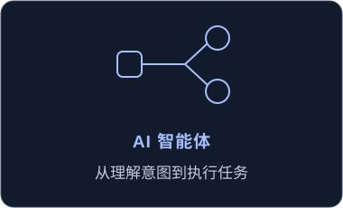
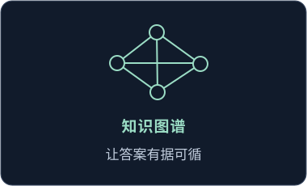
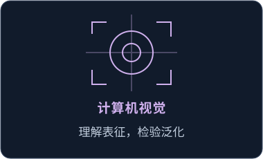
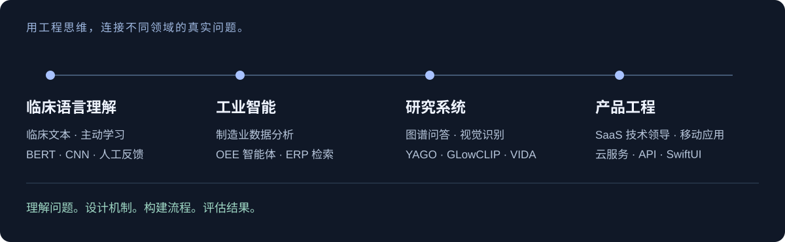

> **寻求 2027 年 3 月起的实习或全职机会**  
> 人工智能研究 · 人工智能工程 · [联系我](mailto:jiangshan1030@gmail.com)

# 崔江山 · Jerry Cui

**我将研究问题、业务需求与工程实践连接起来，让人工智能真正服务于实际任务。**

我的经历涵盖临床自然语言处理、制造业数据分析、知识图谱推理、视觉识别和应用开发。我也曾带领五人工程团队，既关注模型本身，也重视模型之外的系统设计与产品实现。

[领英](https://www.linkedin.com/in/jiangshancui/) · [电子邮件](mailto:jiangshan1030@gmail.com)

## 探索我的项目

<table><tr>
<td width="33%"></td>
<td width="34%"></td>
<td width="33%"></td>
</tr></table>

## 我能为团队带来什么

| 核心能力 | 实践方式 | 项目与经历 |
| :--- | :--- | :--- |
| **将研究思路转化为实现** | 模型适配、对照实验与失效模式分析 | [GLowCLIP](https://github.com/Jerry00C/GLowCLIP)、[VIDA](https://github.com/Jerry00C/Vida)、临床 NLP 研究 |
| **结合行业问题应用 AI** | 将语言模型连接到制造数据、ERP 文档和结构化知识 | [OEE 智能体](https://github.com/Jerry00C/oee-analysis-ai-agent)、[Plex RAG](https://github.com/Jerry00C/plex-rag)、[YAGO](https://github.com/Jerry00C/yago-sparql-demo) |
| **覆盖模型之外的工程工作** | 构建 API、校验机制、编排流程、交互界面与人工审核环节 | [化学教学视频生成器](https://github.com/Jerry00C/EduVideoGenerator)、[AI 日历](https://github.com/Jerry00C/ai-calendar) |
| **技术领导力与团队协作** | 在 Utechia 带领五人工程团队，参与协作式智能体项目 | SaaS 平台与云基础设施；[房地产智能助手](https://github.com/zhexusun10/Multi-Agent-Assistance-System) |

<b>技术工具箱：与实际项目相对应</b>

| 领域 | 工具与方法 |
| :--- | :--- |
| 机器学习与视觉 | Python、PyTorch、CLIP、DINO、LoRA、CNN、BERT、主动学习 |
| 智能体与检索 | LangChain、结构化输出、Pydantic、工具调用、SPARQL、Neo4j、Pinecone |
| 应用开发 | FastAPI、TypeScript、Node.js、React Native、SwiftUI、Java / Android |
| 基础设施与数据 | AWS、Docker、Kubernetes、Kafka、SQL、MongoDB、ClickHouse |

这些工具来自我的项目实践与工作经历；对应项目链接展示了具体应用场景。

## AI 智能体
**让系统从理解意图走向执行任务。**

| 项目 | 解决的问题 | 工程重点 |
| :--- | :--- | :--- |
| [OEE 制造分析智能体](https://github.com/Jerry00C/oee-analysis-ai-agent) | 用自然语言查询制造业生产表现 | SQL 工具、数据预处理、模块化分析 |
| [多智能体房地产助手](https://github.com/zhexusun10/Multi-Agent-Assistance-System) | 对话式房源搜索、推荐、解释与看房协调 | 智能体编排、偏好记忆、检索、人工审核 |
| [化学教学视频生成器](https://github.com/Jerry00C/EduVideoGenerator) | 将化学问题转化为带旁白的可视化讲解 | 推理、校验、场景规划、动画生成 |
| [项目与学生匹配系统](https://github.com/AndyYeom/Intern-Assignment-Agent) | 提取结构化技能需求，完成约束下的匹配 | 多智能体组件、遗传算法、导师审核 |
| [AI 日历](https://github.com/Jerry00C/ai-calendar) | 将截图和照片转化为可编辑的日历事件 | 多模态提取、React Native、FastAPI、审核流程 |

*房地产助手和项目与学生匹配系统为团队协作项目。房地产项目仓库明确标注了我负责的原生推荐实现。OEE 仓库展示公司项目的公开示例；AI 日历处于 MVP 阶段；匹配结果为待审核草案。*

## 知识图谱与检索
**让答案有据可循。**

| 项目 | 解决的问题 | 工程重点 |
| :--- | :--- | :--- |
| [YAGO LLM-to-SPARQL](https://github.com/Jerry00C/yago-sparql-demo) | 基于知识图谱的事实问答 | 结构化提取、谓词白名单、单跳 SPARQL、可视化执行过程 |
| [Plex RAG](https://github.com/Jerry00C/plex-rag) | 基于企业 ERP 文档回答问题 | PDF 导入、分块、嵌入、Pinecone 检索 |

我的相关研究还包括 YAGO 到 Neo4j 的数据导入、FastRP 图嵌入和知识图谱问答。这些研究实验与公开的 YAGO V1 演示不同；V1 使用直接的单跳 SPARQL 查询。

## 计算机视觉
**观察细节，检验泛化。**

| 项目 | 研究问题 | 研究重点 |
| :--- | :--- | :--- |
| [GLowCLIP](https://github.com/Jerry00C/GLowCLIP) | 图像质量退化条件下的 AI 生成图像检测 | CLIP、全局与局部特征融合、一致性目标 |
| [VIDA](https://github.com/Jerry00C/Vida) | 利用互补信号检测 AI 生成视频 | 视觉编码器适配、时序特征、异常信号、校准融合 |

我在 VIDA 中的工作重点是视觉编码器迁移学习与评估。当前仓库记录了更完整的三分支系统，也包含格式控制实验，揭示固定判定阈值在分布变化下的局限。

## 移动应用工程
**交互界面也是系统的一部分。**

- [ReformFIT iOS](https://github.com/Jerry00C/ReformfitAppIOS)：基于 SwiftUI 的健身应用，涵盖课程信息、会员功能、健康工具，并集成 Firebase 和 LiveChat。
- [ReformFIT Android](https://github.com/Jerry00C/ReformfitAppAndroid)：基于 Java / AndroidX 的应用，涵盖课程安排、预约相关流程，并集成 Mindbody 和 Firebase。

*这些是较早期的开发版本；当前配置要求与局限请参阅各仓库的 README。*

## 代码仓库之外的经历

- **临床 NLP · 多伦多大学：** 使用 BERT、CNN、主动学习和人工反馈，研究从临床文本中提取健康社会决定因素。
- **企业 AI · 万丰 / Meridian：** 制造业数据分析与 ERP 知识检索。
- **客户数据整合 · Diamond Aircraft：** 评估 Salesforce、FAA 与外部数据源的整合方案及技术取舍。
- **全栈工程领导 · Utechia：** 带领五人团队开发 SaaS 平台及云基础设施。
- **软件工程 · Informatica：** 参与微服务协作开发，并开发基于机器学习的情感分析工具。

---
**以研究探索问题，以工程实现价值，以产品连接用户。**

[联系我，交流实习或全职机会](mailto:jiangshan1030@gmail.com)
